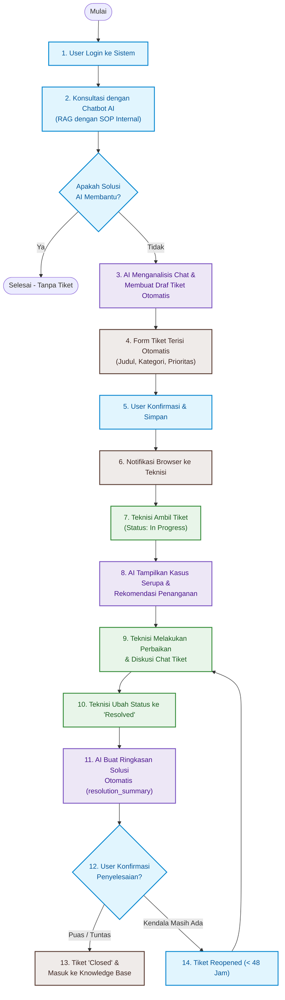

# 🚀 HelpDesk AI — Intelligent IT Support & Automated Ticketing System

<p align="center">
  
  
  
  
  
  
  
</p>

<p align="center">
  <strong>HelpDesk AI</strong> adalah sistem manajemen layanan IT Helpdesk tingkat enterprise berbasis web yang mengintegrasikan <em>Retrieval-Augmented Generation</em> (RAG) dengan model bahasa besar (Google Gemini AI via OpenRouter) untuk menyelesaikan kendala teknis operasional secara otomatis, cepat, dan presisi.
</p>

---

## 📌 Daftar Isi
- [Ringkasan Eksekutif & Problem Statement](#-ringkasan-eksekutif--problem-statement)
- [Hasil Pengujian & Efisiensi Riset (Benchmark)](#-hasil-pengujian--efisiensi-riset-benchmark)
- [Fitur Utama Sistem](#-fitur-utama-sistem)
- [Arsitektur Sistem & Alur Kerja](#-arsitektur-sistem--alur-kerja)
- [Teknologi yang Digunakan](#-teknologi-yang-digunakan)
- [Struktur Direktori Proyek](#-struktur-direktori-proyek)
- [Panduan Instalasi & Menjalankan Proyek](#-panduan-instalasi--menjalankan-proyek)
- [Akun Demo Siap Pakai](#-akun-demo-siap-pakai)
- [Pengujian Otomatis Benchmark AI](#-pengujian-otomatis-benchmark-ai)
- [Dokumentasi Lengkap](#-dokumentasi-lengkap)

---

## 💡 Ringkasan Eksekutif & Problem Statement

Di lingkungan operasional ritel dan multi-cabang, kendala teknis pada perangkat **Hardware POS (Point of Sale)**, **Printer Thermal**, **Barcode Scanner**, **Jaringan & Internet**, **CCTV**, hingga **Server Database** sering kali menghambat transaksi penjualan secara langsung. 

Tantangan utama yang dihadapi meliputi:
1. **Waktu Pelaporan Manual yang Lambat:** Karyawan toko/kasir membutuhkan waktu lama untuk mengisi form tiket secara manual dan sering kali kesulitan menjelaskan gejala teknis secara akurat.
2. **Beban Berulang pada Tim Teknisi (Tier-1 Overload):** Banyak kendala sepele (seperti sensor kertas printer tersangkut atau port USB scanner longgar) yang sebenarnya dapat diatasi mandiri jika ada panduan SOP yang tepat.
3. **Penyusunan Solusi Tanpa Standarisasi:** Solusi penanganan tiket terdahulu sering tidak terdokumentasi rapi, sehingga teknisi baru harus mengulang proses investigasi dari nol.

**HelpDesk AI hadir sebagai solusi end-to-end**:
- Berfungsi sebagai **Asisten AI Lini Pertama (Tier-1)** yang memberikan solusi instan berdasarkan SOP internal perusahaan.
- Melakukan **Triage & Auto-Drafting Tiket** secara otomatis dari riwayat obrolan jika kendala memerlukan penanganan fisik oleh teknisi.
- Memberikan **Rekomendasi Kasus Serupa** dan **Ringkasan Solusi Otomatis** untuk mempercepat waktu penyelesaian tiket (*Mean Time to Resolution*).

---

## 📊 Hasil Pengujian & Efisiensi Riset (Benchmark)

Berdasarkan pengujian empiris terhadap **30 skenario kendala teknis riil** di lapangan:

| Metrik Evaluasi | Input Manual Tradisional | Dengan Asisten AI | Dampak & Efisiensi |
| :--- | :---: | :---: | :---: |
| **Rata-rata Waktu Pembuatan Tiket** | **66,03 detik** | **31,97 detik** | 🚀 **51,58% Lebih Cepat** |
| **Akurasi Penentuan Kategori & Prioritas** | Subjektif pengguna | Otomatis terstandar | 🎯 **100% Valid (30/30 Kasus)** |
| **Tingkat Kebutuhan Revisi Manual** | Sering salah input | Langsung siap kirim | ✅ **0% Revisi (Perlu Diedit: Tidak)** |

> 📄 *Lihat rincian lengkap 30 skenario pengujian di dokumen [docs/BENCHMARK.md](docs/BENCHMARK.md).*

---

## ✨ Fitur Utama Sistem

### 1. 🤖 AI Virtual Helpdesk (RAG-Powered Chatbot)
- Terintegrasi langsung dengan **Google Gemini AI** melalui gateway **OpenRouter**.
- Dilengkapi mekanisme **RAG (Retrieval-Augmented Generation)** yang memindai SOP internal dari basis data sebelum menjawab pertanyaan pengguna.
- Dilengkapi **Domain Guardrails**: Menolak percakapan non-teknis secara sopan dan memfokuskan respons pada solusi teknis terstruktur.
- Memiliki fitur pemulihan cerdas (*fallback*) jika terjadi kendala koneksi API luar.

### 2. ⚡ Smart Ticket Auto-Drafting
- AI mengevaluasi percakapan pengguna untuk mendeteksi:
  - **Subjek Masalah** yang ringkas dan deskriptif.
  - **Kategori Masalah** (Hardware POS, Printer Thermal, Scanner, Jaringan, CCTV, Server).
  - **Tingkat Prioritas** (Low, Medium, High).
  - **Rangkuman Gejala & Solusi Awal**.
- Form pengaduan terisi otomatis (*auto-prefill*), pengguna cukup memeriksa dan menekan tombol konfirmasi.

### 3. 👥 Role-Based Access Control (RBAC) Terpadu
- **Administrator:** Hak akses penuh, manajemen seluruh akun & role pengguna, konfigurasi Knowledge Base/SOP, serta analitik & pelaporan eksekutif.
- **IT Support / Teknisi:** Dashboard statistik penanganan, fitur klaim tiket mandiri (*self-assignment*), pembaruan status dan prioritas, riwayat penanganan, serta chat diskusi tiket.
- **Pengguna / Karyawan:** Konsultasi chatbot interaktif, pembuatan tiket, riwayat pengaduan, verifikasi penyelesaian tiket, dan fasilitas buka kembali (*reopen*) dalam 48 jam.

### 4. 🔍 AI Similar Tickets & Auto-Resolution Summary
- **Rekomendasi Kasus Serupa:** AI memindai basis data tiket masa lalu yang berstatus `resolved` atau `closed` untuk menampilkan hingga 3 tiket teratas yang identik beserta solusi sukses yang pernah diterapkan.
- **Ringkasan Solusi Otomatis:** Saat teknisi menyelesaikan tiket, AI secara otomatis merangkum percakapan teknis menjadi catatan penyelesaian standar pada kolom `resolution_summary`.

### 5. 📈 Executive Analytics & Printable PDF Reports
- Visualisasi metrik total tiket, rasio status (`open`, `progress`, `resolved`, `closed`), dan distribusi prioritas.
- Grafik tren pelaporan bulanan (6 bulan terakhir).
- Peringkat SLA dan produktivitas teknisi IT support.
- Halaman **Cetak Laporan Khusus / Export PDF** siap print dengan filter tanggal, status, kategori, dan tanda tangan penanggung jawab.

### 6. 🔔 Web Browser Push Notification
- Notifikasi berbasis **Web Notifications API** yang langsung muncul di layar browser saat ada tiket baru, penugasan teknisi, atau pembaruan status tanpa perlu me-refresh halaman.

---

## 📐 Arsitektur Sistem & Alur Kerja



> 📐 *Penjelasan rinci Use Case, Sequence Diagram, dan ERD Class Diagram tersedia di [docs/ARCHITECTURE.md](docs/ARCHITECTURE.md).*

---

## 🛠️ Teknologi yang Digunakan

| Layer | Teknologi | Peran & Keterangan |
| :--- | :--- | :--- |
| **Backend Framework** | [Laravel 10.x](https://laravel.com/) | MVC architecture, Eloquent ORM, Gate/Policy authorization |
| **Language** | [PHP 8.1+](https://www.php.net/) | Modern typed PHP dengan fitur strict typing |
| **Frontend UI** | [Tailwind CSS 3.x](https://tailwindcss.com/) & [Alpine.js](https://alpinejs.dev/) | Antarmuka responsif modern, micro-interactions, modal dialog |
| **Build Tool** | [Vite 5.x](https://vitejs.dev/) | Hot Module Replacement (HMR) & optimasi aset frontend |
| **AI / LLM Integration** | [Google Gemini 2.0 / OpenRouter](https://openrouter.ai/) | Penyedia LLM fleksibel dengan latency rendah & RAG context injection |
| **Database** | [MySQL 8.0](https://www.mysql.com/) | Relational database dengan indexing foreign keys & full-text search |
| **Notification Engine** | HTML5 Web Notifications API | Notifikasi real-time native browser |
| **Testing & Benchmark** | PHPUnit & Standalone CLI Benchmark Suite | Pengujian fungsional dan evaluasi akurasi 30 kasus AI |

---

## 📁 Struktur Direktori Proyek

```plaintext
helpdesk_ai/
├── app/
│   ├── Http/Controllers/
│   │   ├── AdminController.php         # Manajemen akun pengguna & hak akses role
│   │   ├── ChatbotController.php       # Engine obrolan AI, session limit, & ticket drafting
│   │   ├── KnowledgeBaseController.php # Manajemen artikel SOP dan knowledge base
│   │   ├── NotificationController.php  # Pengelolaan notifikasi pengguna
│   │   ├── ReportController.php        # Analitik SLA, metrik bulanan, & export print
│   │   └── TicketController.php        # Lifecycle tiket, similar tickets, & auto-summary
│   ├── Models/                         # Eloquent Models (Ticket, User, ChatMessage, dll.)
│   └── Services/
│       └── KnowledgeBaseService.php    # Modul RAG & pencarian SOP kontekstual
├── database/
│   ├── migrations/                     # Skema tabel database
│   └── seeders/                        # Data awal akun, 40 pengguna, SOP, & riwayat tiket
├── diagrams/                           # Sumber diagram HTML (Mermaid) & Draw.io
├── docs/                               # Dokumentasi arsitektur dan portofolio
│   ├── ARCHITECTURE.md                 # Alur diagram, Use Case, Sequence, & Class Diagram
│   ├── BENCHMARK.md                    # Data empiris pengujian 30 kasus kendala POS
│   └── AI_SYSTEM_AND_RAG.md            # Arsitektur pipeline RAG & Prompt Engineering
├── resources/
│   ├── views/                          # Blade templates (UI Dashboard, Chat, Tickets, Reports)
│   ├── css/                            # Tailwind CSS styles
│   └── js/                             # JavaScript & Web Notification handlers
├── routes/
│   └── web.php                         # Routing aplikasi dengan middleware auth & role
├── tests/
│   ├── run_test_cases.php              # Automated CLI benchmark runner (30 kasus)
│   ├── generate_test_results.php       # Generator tabel evaluasi metrik waktu & akurasi
│   └── test_ai.php                     # Script validasi konektivitas API OpenRouter
├── .env.example                        # Template konfigurasi environment (termasuk AI keys)
└── composer.json                       # Konfigurasi dependensi backend PHP
```

---

## 🚀 Panduan Instalasi & Menjalankan Proyek

### Prasyarat Sistem
- **PHP:** >= 8.1 (dengan ekstensi `pdo_mysql`, `mbstring`, `curl`, `openssl`)
- **Composer:** >= 2.x
- **Node.js & NPM:** >= 18.x
- **Database:** MySQL >= 8.0 atau MariaDB >= 10.4

### Langkah-Langkah Instalasi

1. **Clone Repositori:**
   ```bash
   git clone https://github.com/username/helpdesk_ai.git
   cd helpdesk_ai
   ```

2. **Instal Dependensi Backend:**
   ```bash
   composer install
   ```

3. **Instal Dependensi Frontend:**
   ```bash
   npm install
   ```

4. **Konfigurasi Environment:**
   Salin file `.env.example` menjadi `.env`:
   ```bash
   cp .env.example .env
   php artisan key:generate
   ```

   Buka file `.env` dan sesuaikan kredensial database serta API key OpenRouter Anda:
   ```env
   DB_CONNECTION=mysql
   DB_HOST=127.0.0.1
   DB_PORT=3306
   DB_DATABASE=helpdesk_ai
   DB_USERNAME=root
   DB_PASSWORD=

   # Konfigurasi AI (OpenRouter)
   OPENROUTER_API_KEY=your_openrouter_api_key_here
   OPENROUTER_MODEL=google/gemini-2.0-flash-exp:free
   ```

5. **Migrasi Database & Seeding Data Demo:**
   ```bash
   php artisan migrate:fresh --seed
   ```
   *Perintah ini akan membuat seluruh tabel dan mengisi data demo pengguna, SOP ritel, serta contoh tiket historis.*

6. **Kompilasi Aset Frontend:**
   ```bash
   npm run build
   # Atau untuk mode pengembangan (Hot Reload):
   npm run dev
   ```

7. **Jalankan Web Server Lokal:**
   ```bash
   php artisan serve
   ```
   Akses aplikasi di browser melalui URL: `http://127.0.0.1:8000`

---

## 👥 Akun Demo Siap Pakai

Setelah proses *seeding* database selesai, Anda dapat langsung masuk menggunakan akun pengujian berikut (seluruh akun menggunakan password: `password123`):

| Role | Email | Password | Akses & Wewenang |
| :--- | :--- | :--- | :--- |
| **Administrator** | `abid@gmail.com` | `password123` | Akses penuh, kelola pengguna, kelola SOP, analitik & cetak laporan |
| **IT Support (Teknisi)** | `tsalis@gmail.com` | `password123` | Dashboard teknisi, klaim tiket, update status, rekomendasi AI |
| **IT Support (Teknisi)** | `fajar@gmail.com` | `password123` | Akun teknisi kedua untuk pengujian multi-staf |
| **User (Karyawan/Kasir)** | `siti.aisyah@gmail.com` | `password123` | Chatbot AI, buat tiket otomatis, diskusi tiket, konfirmasi penyelesaian |
| **User (Karyawan/Kasir)** | `muhammad.ilham@gmail.com` | `password123` | Akun karyawan pengadu kedua |

---

## 🧪 Pengujian Otomatis Benchmark AI

Proyek ini dilengkapi dengan suite pengujian CLI mandiri untuk memverifikasi akurasi AI dan mengukur latensi respons:

1. **Uji Koneksi API AI:**
   ```bash
   php tests/test_ai.php
   ```

2. **Jalankan Evaluasi Benchmark 30 Kasus:**
   ```bash
   php tests/run_test_cases.php
   ```

3. **Generate Ulang Laporan Hasil Pengujian:**
   ```bash
   php tests/generate_test_results.php
   ```
   Hasil pengujian akan diperbarui ke file JSON dan tabel markdown terstruktur.

---

## 📚 Dokumentasi Lengkap

Untuk eksplorasi mendalam terkait aspek teknis sistem, silakan telaah dokumen pendukung berikut:
- 🏛️ **[Arsitektur & Diagram Sistem (Flowchart, Use Case, Sequence, Class Diagram)](docs/ARCHITECTURE.md)**
- 🔬 **[Laporan Empiris Pengujian 30 Kasus Kendala Hardware & POS](docs/BENCHMARK.md)**
- 🧠 **[Arsitektur Pipeline AI & Retrieval-Augmented Generation (RAG)](docs/AI_SYSTEM_AND_RAG.md)**

---

## 📄 Lisensi

Proyek ini dirilis di bawah lisensi terbuka [MIT License](LICENSE).
